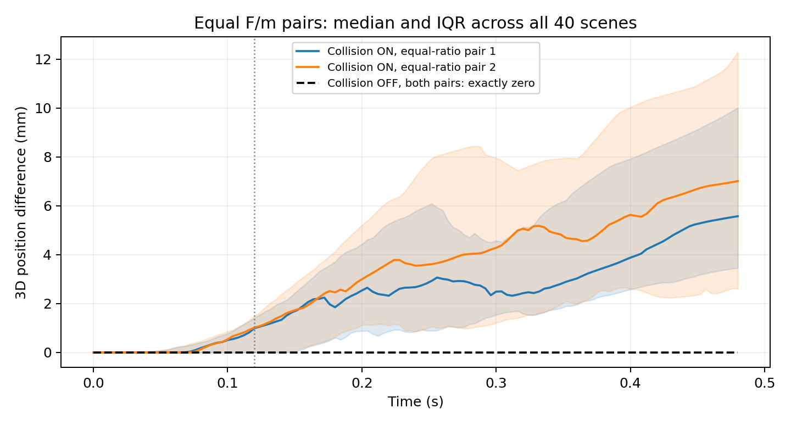

# 从可观测性到可编辑性：冻结 I-JEPA 表示中物理组合与视觉子空间的诊断

> 中文研究初稿，2026-10-13。当前定位为实证诊断与方法探索。本文不宣称发现新的物理定律、获得完整因果解耦，或证明 JEPA 优于其他编码器。主要证据来自一个 CausalWorld 设置和冻结 I-JEPA；进一步的跨环境独立确认尚未完成。

## 摘要

解释视觉表示中的物理因素，首先需要区分三个问题：输入是否允许辨识该因素，表示是否保留相关信息，以及某种低维变换能否支持可迁移的解释和编辑。我们对冻结 I-JEPA 表示开展受控研究，将模拟器轨迹、RGB观测、表示距离、监督读出和匹配干预编辑分开评价。在40个场景中，我们从相同初态生成质量、施力与机器人碰撞开关的配对分支。关闭机器人—物体碰撞时，预先指定的80组等施力质量比参数对具有完全相同的含初态的121个时刻物体状态、9帧RGB和对应表示；这排除了仅依靠这些观测唯一恢复两组参数的可能性，但不排除组合量的可读性。固定线性读出在8个留出场景上预测对数施力质量比的R²为0.674；开启碰撞后为0.140。碰撞通常打破上述别名，却未使有限样本的线性读出更容易。另一个独立的静态视觉干预实验表明，每场景两帧固定参照可改善同分布颜色编辑，但在背景灰度范围外仍劣于不编辑。上述结果支持一种以可观测性、信息保留和功能验证为顺序的解释流程，并限定了独立坐标、线性可读性与可迁移因素编辑之间的关系。

## 1. 研究问题与动机

自监督视觉编码器为图像提供高维表示，但可预测、可分类或可压缩并不自动等价于找到了独立的生成因素。相关研究已指出可辨识性需要额外条件，后处理理论也依赖具体的表示假设（[Locatello等，2019](https://proceedings.mlr.press/v97/locatello19a.html)；[DSReg](https://arxiv.org/html/2610.09457v1)）。本文关注冻结表示的后处理：能否通过正交或非正交变换、分块、条件子空间和有限监督诊断，获得可复用的因素解释？我们的目标不是要求编码器在所有任务上优于其他模型，而是建立能被反证的解释，并找出解释失败发生在哪一层。

需要首先区分“参数可独立设置”和“参数可从观测独立辨识”。模拟器可以分别改变质量m和外力F，但如果两种设置生成完全相同的观测，任何确定性的后处理都不能从该观测恢复两者的唯一取值。反过来，没有唯一参数识别能力并不意味着表示没有物理信息：F/m等组合仍可能可读。同样，线性预测器的一维输出可以准确预测某个目标，却不意味着原表示只有一个携带该目标的方向。

我们围绕三个问题组织实证证据。首先，物理参数的别名来自观测、编码还是读出？其次，可观测组合是否集中于低维表示，去除一个读出方向是否真的去除信息？最后，受控视觉因素的分块解释能否在匹配干预编辑和新场景中成立？三者分别涉及辨识边界、统计可读性和功能有效性，不能由单个探针分数代替。

当前工作的可陈述贡献是一个有明确作用范围的配对诊断流程、物理参数别名的状态—像素—表示证据链，以及包含失败边界的冻结表示后处理实验。缩放对称性、线性探针、PCA和概念擦除均来自已有研究；本文是否构成足够强的新方法贡献，仍取决于后续独立确认和更广泛的适用性证据。

## 2. 与已有研究的关系

完整书目信息、稳定引用键、版本及核验边界维护于[独立参考文献登记](references.md)。以下区分已有理论、已有解释方法与本文的受控实证增量；我们不主张首次提出可观测性审计、表示干预或因素后处理。

**联合嵌入预测与物理诊断。** [I-JEPA（Assran等，2023）](https://arxiv.org/abs/2301.08243)通过预测同一图像中的目标块表示学习图像特征；[V-JEPA（Bardes等，2024）](https://arxiv.org/abs/2404.08471)将特征预测用于视频表征。本文使用冻结单图像I-JEPA，并在编码后拼接或差分多个时刻，未检验训练好的视频或动作条件动力学预测器。更直接的近期近邻是[RateIdent/TI-JEPA（Zhang等，2026）](https://arxiv.org/abs/2610.04585)：其研究无运动模糊单帧输入的速度盲区，并提出诊断与运动表示修复；[PSG-JEPA（Yan等，2026）](https://arxiv.org/abs/2608.06799)利用本体状态和多时距关节变化训练目标强化表示；[PhyLatent（Zeng等，2026，v2）](https://arxiv.org/abs/2608.05720v2)区分外观不变性、物理状态区分及动作条件未来区分问题。这些工作已说明预测训练或全局不坍塌不等于满足全部物理使用要求。本文不提出对应的新训练目标，关注的是接触机制切换如何改变多帧输入下的参数别名，以及这种改变与固定读出能力的区别；尚未提供与上述方法匹配的规划比较。

**参数可辨识性与潜变量识别。** 不同参数产生相同输出属于已有的结构可辨识性问题，缩放不变性是其中一种来源；仅排除缩放对称性也不足以证明一般系统可识别（[Castro与de Boer，2020](https://journals.plos.org/ploscompbiol/article?id=10.1371/journal.pcbi.1008248)；[Villaverde与Massonis，2021](https://journals.plos.org/ploscompbiol/article?id=10.1371/journal.pcbi.1009032)）。因此，F/m缩放不是本文的新物理发现，我们提供的是给定接触、初态、动作信息和传感器条件下的状态—像素—表示核验。[Locatello等（2019）](https://proceedings.mlr.press/v97/locatello19a.html)则研究一般无监督解耦缺乏归纳偏置时的潜变量歧义；这与本文具体实验输入中的参数别名相关，但不是同一个结论。当前别名不能否定加入已知施力、额外传感器或不同实验设计后的识别可能性。

**利用辅助信息的因果表示学习。** [CITRIS（Lippe等，2022）](https://proceedings.mlr.press/v162/lippe22a.html)利用时序和已观察干预目标，研究标量及多维因素的可辨识性，并支持预训练autoencoder表示的后处理；[BISCUIT（Lippe等，2023）](https://proceedings.mlr.press/v216/lippe23a.html)研究二值交互条件下的因果表示学习。[Brehmer等（2022）](https://proceedings.neurips.cc/paper_files/paper/2022/hash/fa567e2b2c870f8f09a87b6e73370869-Abstract-Conference.html)利用未知干预前后的配对样本研究弱监督识别；[机制稀疏正则（Lachapelle等，2022）](https://proceedings.mlr.press/v177/lachapelle22a.html)及其[非参数部分解耦扩展（2026）](https://www.jmlr.org/beta/papers/v27/24-0771.html)系统研究稀疏动作、干预及时间依赖。本文没有复现这些方法的全部识别条件；记录碰撞开关、利用因素标签拟合读出或增加历史，本身都不是新的因果识别原理。

**冻结表示的坐标恢复与概念提取。** [DSReg（Zheng等，2026，v1）](https://arxiv.org/html/2610.09457v1)在已满足线性可辨识前提的表示上，利用Structural Diversity和functional no-cancellation等条件恢复个体因素。本文普通I-JEPA特征尚未证明满足这些前提，已有DSReg实验是局部依赖估计与降维设定下的适配，不代表完整官方复现，也不构成原定理的反例。另一条解释路线是字典学习：[Archetypal SAE（Fel等，2025）](https://proceedings.mlr.press/v267/fel25a.html)研究视觉模型SAE字典的不稳定性，并通过数据几何锚定改善稳定性。它提示概念原子需要稳定性与外部验证；我们当前没有据此获得无监督物理因素，不能将低维或稀疏表示本身当作证据。

**可读、可擦除与可干预不是同一性质。** [Hewitt与Liang（2019）](https://aclanthology.org/D19-1275/)用控制任务说明探针表现需要结合探针容量解释；其语言任务结论不能直接替代本项目对场景或进度捷径的检查。[LEACE（Belrose等，2023）](https://papers.nips.cc/paper_files/paper/2023/file/d066d21c619d0a78c5b557fa3291a8f4-Paper-Conference.pdf)给出闭式线性概念擦除，说明删除单个预测权重方向与消除全部线性可读信息不同；线性擦除也不保证非线性或分布外信息消失。我们分别报告监督读出、残余读出和匹配编辑，而不把任一成功作为完整概念隔离的充分条件。

**干预响应与功能解释。** [因果抽象（Geiger等，2021）](https://arxiv.org/abs/2106.02997)使用interchange interventions检验神经表示的因果角色，[DAS（Geiger等，2024）](https://proceedings.mlr.press/v236/geiger24a.html)进一步学习分布式坐标对齐；因此“旋转或分块后进行移植”已有直接方法先例。成功的子空间patching也可能产生解释错觉，不能独自证明该子空间承载原模型的相应计算（[Makelov等，ICLR2024](https://openreview.net/pdf?id=Ebt7JgMHv1)）。在JEPA方向，[CI-JEPA（Dutta等，2026）](https://arxiv.org/abs/2610.05043)已研究原图与受控改图的表示差及选择性响应。本文使用模拟器真实匹配干预与跨场景参照评价特征编辑，并保留其失败边界；这比相关性读出增加了受控验证，但尚未证明原生预测器、策略或物理系统中的行为因果作用。本文的新增范围是这些证据在同一受控案例中的分层核验及作用边界，而非替代已有因果表示或机制解释理论。

## 3. 诊断框架

### 3.1 观测等价类

令场景初态为s，物理参数为θ=(m,F)，接触设置为c，模拟器轨迹为x₀:T=G(s,θ,c)，观测为o₀:T=R(x₀:T)，冻结编码器为zₜ=f(oₜ)。在给定场景、采样时间及传感器条件下，定义θ~θ′当且仅当观测序列完全相同。对于任意确定性变换h，θ~θ′蕴含h(f(o₀:T))相同。因此，更换旋转、分块或非线性读出不能单凭这些输入区分该参数对。随机预测器也不能从相同条件分布中增加个体辨识信息。

这是确定性映射对相等输入保持相等的直接推论，不作为新的可辨识性定理。这一陈述不要求所有参数都不可辨识。我们使用三种质量和三种力的平衡九格，其中只有两组预定参数对具有相同F/m；九格共有七种比值。在已验证的OFF数据中，这两组参数对逐值共享相同输入；这由状态、图像和表示检查确认，不能仅由比值相等推定。对于九格等权且没有真实力等区分侧信息的条件，每个同值输入组包含两种质量和两种外力，因此纯观测的质量三分类、外力三分类或联合九分类准确率最多为7/9。该上限允许其余五个单例都正确，并非1/3随机水平；额外的观测混叠可能进一步降低上限。提供真实施力动作会改变输入条件，此上限不直接适用。

### 3.2 先检查物理与像素，再检查表示

同初态配对生成时保留完整物体状态、机器人状态与接触日志。先验证参数确实生效、初态一致、重复可复现、非目标变量符合协议；再检查轨迹和RGB相等性；最后分析表示距离。这样可以区分输入本身没有区别、编码丢失区别以及有限读出未利用区别。该顺序不以读出失败直接推断表示没有信息。

对两组预定等比参数对，表示几何采用它们的欧氏距离，除以相同anchor到七个异比格的距离中位数。先对每场景的两组取均值，再汇总场景。该指标使用配对标签，属于干预几何诊断；初始帧分母为零时记为NA。

### 3.3 低维可读性与擦除

物理读出输入固定为u=[z₃₀−z₀;z₁₂₀−z₀]。仅训练场景拟合中心化、不白化PCA32；各接触模式分别训练对数比值、对数质量和对数外力三个岭回归模型。超参数α∈{10⁻⁵,10⁻³,0.1,1,10}仅用调参场景选择。对数采用质量kg、力N对应的数值，等价于固定参考单位后的无量纲对数；单位变换只改变截距。报告场景等权对数MSE和R²=1−SSE/SST，后者使用开发集目标均值定义SST。

后续探索比较PCA前1、2、4、8、16、32维。PCA方向拟合不使用物理标签，但读出训练与评价使用标签；因此“无标签压缩”不等于“无监督发现物理概念”。将原岭回归输出改写为沿其权重向量的一维坐标，与原预测在代数上等价，不构成新发现。去除该方向后的残余读出用于检查冗余编码，不能单独证明概念已经被完全擦除。进一步的[LEACE](https://papers.nips.cc/paper_files/paper/2023/file/d066d21c619d0a78c5b557fa3291a8f4-Paper-Conference.pdf)对照使用前16个训练场景拟合擦除、后8个拟合探针；两者共享全部24个训练场景拟合的无标签PCA。标签拟合子集分开，开发场景不参与拟合，避免将同一训练集的零协方差构造恒等式当作泛化证据。采用连续目标平方损失版本的float64解析公式，不使用收缩或trace约束；五个岭系数仍由原调参集选择。

### 3.4 表示编辑的验证

静态视觉实验使用位置、物体颜色与背景因素的匹配图像，拟合正交因素块；跨场景编辑后与接收场景中真实匹配干预的表示比较。每场景两帧固定factor-code参照用于平移校准。这需要额外参照数据，且分块训练利用干预信息，属于弱监督方法。

编辑误差以“不编辑”的逐编辑误差归一化，再按场景对等权汇总。另报告目标检索、非目标保持和真实联合干预误差。正交块的交换性是结构保证，不能用来证明物理因果独立；参考库检索也不是图像生成或物理操控成功。这与[因果抽象的交换干预](https://arxiv.org/abs/2106.02997)所需行为对应证据有区别，也需防范[子空间patching解释错觉](https://arxiv.org/abs/2311.17030)。

## 4. 实验设置

### 4.1 接触配对数据

使用[CausalWorld](https://arxiv.org/abs/2010.04296)及其[官方实现](https://github.com/rr-learning/CausalWorld)的推动设置，40个场景各自新建环境，固定随机种子20261018；另2个场景只用于生成审计。每场景从同一已稳定初态生成质量{0.01,0.02,0.04}kg、世界+x方向外力{0.01,0.02,0.03}N和机器人—物体碰撞ON/OFF的18个分支。地面接触保留；机器人始终可见。外力作用在物体瞬时质心，前30步持续施加，每步0.004秒，共120步；保存初态及全部121个物理状态，在步{0,1,5,10,20,30,60,90,120}保存RGB。

数据包含720个学习分支、80个重复基线分支和6480帧学习图像。固定24/8/8场景划分，对应每接触模式216/72/72个学习分支。重复基线不用于训练。每次分支恢复物体与机器人状态并显式设置碰撞过滤，记录实际质量、摩擦和惯量。OFF是移除碰撞的反事实：初始可能存在几何重叠或释放瞬态，不能解释为机器人从物理场景消失。

### 4.2 表示与统计单位

主要编码为冻结I-JEPA的1280维全局均值与5120维空间网格池化特征。物理读出固定使用后者的双时刻差分。当前没有在该配对实验上完成其他编码器的容量匹配比较，因此不提出JEPA特有优势。

统计独立单位是场景；九格分支和同一场景中的时间帧不是独立场景。物理相等性报告全部40场景；泛化读出只报告留出的8场景。G5j预先固定了六模型，G5k及后续擦除复用已查看的开发集，明确属于探索。独立数值复算验证实现一致性，不等价于另一次独立科学复现。

## 5. 结果

### 5.1 接触改变别名，但不保证更容易读出

OFF的80/80等比参数对在完整121×13维物体状态、全部九帧RGB、两种池化表示上逐值完全相同。ON仍有4/80组保持完全相同，说明接触不是必然提供区分信息。ON的360个学习分支中343个记录到机器人接触法向力大于10⁻⁸ N，OFF所有分支全程该力为零；全部720个分支保留正地面接触力。

图1：每场景两组预定等F/m配对的物体位置差异，每个时刻计算3D位置欧氏差（mm），分别对两组参数在40场景上取中位数与四分位范围；竖线0.12秒表示停止施力。OFF精确为零，ON差异尤其在停力后出现。该图使用全部40个场景描述物理机制，不作为40个独立测试场景的读出结果。

在ON中，两组参数对在施力阶段的位置RMS均值为0.334和0.367mm，停力后为4.543和5.590mm。机器人自身后续状态也改变，故整图表示差异不能全部归因于物体。接触冲量记账残差尚未完全闭合；我们不据此反演质量或声称严格验证了完整力平衡。

留出8场景的grid归一化等比距离在ON中分别为t30的0.4644、t120的0.7945和双差分的0.7510，OFF均为零。这证明当前表示保留了部分接触相关差异，而不是证明已经获得可分离的质量与施力子空间。

### 5.2 可观测组合比独立参数更容易线性读取

| 接触模式 | log(F/m) R² | log(m) R² | log(F) R² |
|---|---:|---:|---:|
| ON | 0.1398 | 0.1332 | 0.0251 |
| OFF | 0.6738 | 0.4313 | 0.2446 |

表1：固定输入、PCA32及五个岭系数的六项读出；各模式独立拟合。该表不是对所有可能读出的最优性声明。ON/OFF改变数据生成机制，因此分数差异不能归因于编码器本身变化。

OFF质量和施力仍有正R²，与别名不矛盾：九格中大部分组合具有不同观测，相同输入也允许预测其条件均值。更复杂的ON观测通常打破两组别名，却使当前有限样本线性比值读出变差。这一区别说明“观测可以区分”与“有限模型容易读出”是不同问题。

使用真实施力作为额外输入，通过log(m̂)=log(F真实)−预测log(F/m)估计质量，得到ON R²=−0.4127、OFF=0.4643。其对数MSE与比值读出代数相同，不是额外独立证据；OFF仅略好于直接质量读出，ON明显更差。当前结果不支持“加入动作已经解决质量识别”。

### 5.3 低维读出不等于唯一因素轴

在复用开发集的固定PCA秩探索中，OFF的1/2/4/8/16/32维比值R²约为0.151/0.374/0.595/0.623/0.657/0.674；ON对应约为0.000/0.0004/0.0008/0.0016/0.070/0.140。OFF的较高方差低维方向已包含可读组合信息，但这些主成分没有被证明逐一对应物理因素。

将监督岭回归映射压缩为其一维输出，预测严格不变；这一结果只是线性函数的等价表达。在未白化PCA32坐标内删除其欧氏权重方向后，剩余31维的重新读出R²为ON约0.0014、OFF约0.3876。该检查只涉及PCA32保留的线性信息，残余可读性不代表多个独立机制。OFF信息仍可读，反对“找到一个预测方向就等于隔离整个概念”的解释。训练场景内打乱比值标签的单一预定种子对照为ON约−0.0119、OFF约0.0686；单种子不是完整置换零分布，不据此给出显著性结论。

有限LEACE补充实验采用匹配的8场景探针训练预算，结果如下。它不与24场景训练的单方向擦除直接排名。

| 接触模式 | 原PCA32 R² | LEACE后 R² | 对数MSE增量（场景配对95%区间） |
|---|---:|---:|---:|
| ON | 0.0479 | 0.0159 | 0.0168 [−0.0147, 0.0488] |
| OFF | 0.5937 | 0.0353 | 0.2937 [0.2313, 0.3489] |

表3：擦除矩阵由另16个训练场景的标签拟合；表中的区间是8个旧开发场景的探索性bootstrap区间，没有对探索家族作多重比较校正。OFF可读线性关联明显降低，但开发集交叉协方差范数仍为擦除前的31.6%，相对特征平方损伤约16.1%。该结果支持协方差擦除作为诊断，不证明完全删除非线性概念或保存了其他任务能力；训练集协方差归零与变换幂等是构造性质。完整结果见[LEACE报告](../docs/leace_observable_report_20261013.txt)。完成此有限对照后停止扩参。

### 5.4 静态编辑：范围内修复与范围外失败同时存在

另一个冻结确认实验包含32个新同分布场景和32个新背景范围外场景，每域16个独立场景对。两参照方法在读取这些新结果前固定。

| 颜色编辑方法 | 同分布相对误差 | 背景范围外相对误差 |
|---|---:|---:|
| 原正交块 | 1.7976 | 3.5321 |
| 每场景两帧参照 | 0.7429 | 1.3978 |
| 不编辑 | 1.0000 | 1.0000 |

表4：相对误差越低越好。背景灰度训练范围为[0.55,0.95]，范围外为[0.25,0.50]。两个范围宽度不同，因此不从绝对分数比较推断一般难度。

两参照相对不编辑的误差差值，同分布为−0.2571，四项预定主要检验的同时95%区间[−0.3000,−0.2142]；范围外为+0.3978，区间[0.2629,0.5326]。这支持范围内修复，并明确否定当前配置的普遍外推成功。使用全部27个匹配参考的特权均值校正，范围外颜色误差仍为1.2719；该事后诊断说明仅改善场景平移估计不足。后续局部模型和更强目标监督没有获得一致修复，保留其失败记录而不继续重复扩参。

### 5.5 其他路线的保留与停止

条件响应子空间使用初帧选择8个近邻训练场景、以有标签干预响应拟合rank≤4空间。旧开发集上，t30质量响应捕获从22.1%提高到28.5%，t120施力从24.0%提高到26.9%；最高覆盖仍低，局部字典总容量更大，不能宣称发现稳定的统一因素块。该方向保留为条件几何的线索，尚不足以作为主方法。

[LIBERO](https://arxiv.org/abs/2306.03310)三个新增任务各50条独立演示，按30/10/10划分。增加历史和训练演示改善了回顾性位移读取，但4个原始帧之后的未来表示预测误差在三个任务上均未优于当前帧基线。回顾位移两端已在输入历史中，不能据此声称学得未来动力学。固定空间分配和有限RBF诊断也未一致修复信息保留与因素选择性；详见[LIBERO历史报告](../docs/history_newtasks_report_20261013.txt)、[空间保留报告](../docs/spatial_information_retention_report_20261012.txt)、[非线性诊断报告](../docs/nonlinear_information_report_20261013.txt)与[证据账本](evidence_ledger.md)。这些结果用于决定路线优先级，不拼接为单一方法的统一性能表。

## 6. 讨论与局限

当前最明确的结论是：设计解释目标之前，应先确定输入允许识别什么。[RateIdent/TI-JEPA](https://arxiv.org/abs/2610.04585)等已有工作已经强调这一问题；我们的证据增量在当前多时刻参数配对和接触开关的具体审计，而非首次提出可观测性诊断。在我们的碰撞移除设置中，独立m、F坐标不是合理的唯一恢复目标，而组合F/m仍然可以被读出。接触通常打破别名，却可能引入更依赖场景的复杂变化，使简单读出更困难。该现象支持分层诊断，而不是“接触有害”或“比值永远是唯一物理因素”的泛化断言。

现有结果尚不能证明因果因素独立变化已经由JEPA恢复。物理独立干预属于模拟器设计；表示中的可读性、选择性编辑与跨场景机制稳定性需要分别成立。静态两参照编辑在限定范围内成功，但其范围外失败、额外校准成本及有标签分块训练必须与成功同时呈现。

主要限制包括单一物体和环境设置、固定相机、离散九格、每模式仅8个开发场景、已复用的探索集，以及整图表示中机器人与物体运动的混合。本文没有验证连续参数外推、未见物体与视角、完整接触力闭合、多步反事实规划，也没有将这些结果推广到V-JEPA。原始相等性不依赖探针能力；低维维数、R²和迁移结论则受当前数据与方法约束。

投稿前优先补充能够改变结论的验证：冻结最有依据的候选，在独立场景和另一种接触/外力设置中检验；引入已知动作后明确识别条件；用容量匹配和对象区域诊断区分场景捷径与物体运动。若固定候选在更适合的场景与一次合理改良后仍失败，应保留负结果并停止扩展，不以反复开发集搜索替代独立证据。

## 7. 结论

我们建立并实际执行了从物理状态、观测相等性、表示几何到读出和匹配编辑的诊断链。在当前受控设置中，参数别名与可读组合同时存在；单方向预测不保证概念隔离；额外参照能够修复范围内编辑，却不能保证外推。下一步方法设计应围绕可观测组合和有明确条件的子空间解释展开，所有更强的独立性、泛化和新颖性主张均需新增证据。

## 可复现性与证据入口

[总计划](../docs/MASTER_PLAN.md)保留全部路线及完成/失败记录。[W批次报告](../docs/contact_mechanism_batch_report_20261013.txt)、[物理生成协议](../docs/causalworld_contact_paired_protocol_20261013.txt)、[六项读出协议](../docs/contact_ratio_readout_protocol_20261013.txt)、[静态两参照报告](../docs/intervention_tworef_report_20261012.txt)为主要方法与结果来源。轻量结果位于[results/](results/)，完整轨迹、特征和逐样本预测存于本地归档，路径与哈希见证据账本。正文参考文献需与[独立文献登记](references.md)逐项对应维护。
